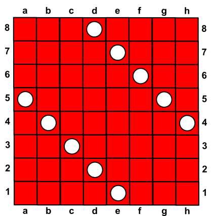

# Sanqi (三棋)

Sanqi (em chinês 三棋, Sānqí, «três xadrezes») é um jogo de estratégia para dois jogadores em que a coordenação entre as peças desempenha um papel central.

Os dois jogadores, as Brancas e as Pretas, jogam à vez. As Brancas começam.

Sanqi joga-se num tabuleiro de xadrez. Cada jogador tem dezasseis peças, que ocupam as duas filas mais próximas de si.

Uma jogada envolve três peças: uma atacante (a peça que se move) e dois apoios (que não se movem). Qualquer peça pode atuar como atacante ou como apoio.

Os dois apoios definem um ponto de pivô, situado exatamente a meio da distância entre eles. Esse ponto pode ficar no centro de uma casa, no ponto médio da aresta entre duas casas ou num vértice onde se encontram quatro casas.

A atacante é movida para o lado oposto do pivô, de modo que este fique exatamente a meio da distância entre a casa de partida e a casa de destino (figura 2). As casas de partida e de destino têm de ser diferentes, mesmo que a atacante se encontre inicialmente sobre um ponto de pivô.

Não existe limite para a distância percorrida, desde que a atacante termine dentro do tabuleiro. A direção do movimento não tem de ser paralela às bordas ou às diagonais do tabuleiro; são possíveis muitas direções.

A casa de destino deve estar vazia ou ocupada por uma peça adversária, que é então capturada e retirada do jogo.

Um jogador perde se não tiver nenhuma jogada legal. Isso pode acontecer, por exemplo, se lhe restarem menos de três peças. Também pode perder por as suas peças se bloquearem umas às outras, impedindo qualquer jogada.

