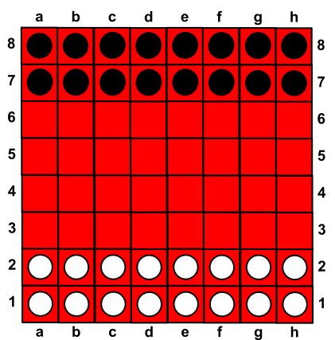
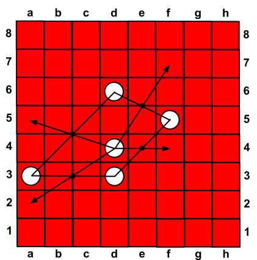

# Sanqi (三棋)

Sanqi (چینی 三棋، Sānqí، یعنی ”تین شطرنج“) دو کھلاڑیوں کا حکمتِ عملی کا کھیل ہے جس میں مہروں کے درمیان تعاون مرکزی کردار ادا کرتا ہے۔

دونوں کھلاڑی، سفید اور سیاہ، باری باری چال چلتے ہیں۔ سفید پہلے چلتا ہے۔

Sanqi شطرنج کے تختے پر کھیلا جاتا ہے۔ ہر کھلاڑی کے پاس سولہ مہرے ہوتے ہیں، جو اس کے قریب ترین دو قطاروں میں رکھے جاتے ہیں۔

ایک چال میں تین مہرے شامل ہوتے ہیں: ایک حملہ آور (جو حرکت کرتا ہے) اور دو مددگار (جو حرکت نہیں کرتے)۔ کوئی بھی مہرہ حملہ آور یا مددگار کا کردار ادا کر سکتا ہے۔

دو مددگار ایک محوری نقطہ متعین کرتے ہیں، جو ان دونوں کے بالکل درمیان ہوتا ہے۔ یہ نقطہ کسی خانے کے مرکز میں، دو خانوں کے درمیان کنارے کے وسط میں، یا اس کونے پر ہو سکتا ہے جہاں چار خانے ملتے ہیں۔

حملہ آور کو محوری نقطے کے پار مخالف جانب منتقل کیا جاتا ہے، اس طرح کہ محوری نقطہ ابتدائی اور منزل کے خانوں کے بالکل درمیان ہو (شکل ۲)۔ ابتدائی اور منزل کے خانے مختلف ہونے چاہییں، چاہے حملہ آور شروع ہی میں کسی محوری نقطے پر موجود ہو۔

حملہ آور کے حرکت کرنے کے فاصلے پر کوئی پابندی نہیں، لیکن اسے تختے کے اندر پہنچنا چاہیے۔ حرکت کی سمت تختے کے کناروں یا قطری خطوط کے متوازی ہونا ضروری نہیں؛ بہت سی سمتیں ممکن ہیں۔

منزل کا خانہ خالی ہونا چاہیے یا اس میں مخالف کا مہرہ ہونا چاہیے۔ مخالف کا مہرہ موجود ہو تو اسے پکڑ کر کھیل سے نکال دیا جاتا ہے۔

اگر کسی کھلاڑی کے پاس کوئی جائز چال نہ ہو تو وہ ہار جاتا ہے۔ مثال کے طور پر، ایسا اس وقت ہو سکتا ہے جب اس کے تین سے کم مہرے باقی رہ جائیں۔ وہ اس وجہ سے بھی ہار سکتا ہے کہ اس کے مہرے ایک دوسرے کا راستہ اس طرح روک رہے ہوں کہ کوئی چال ممکن نہ رہے۔

